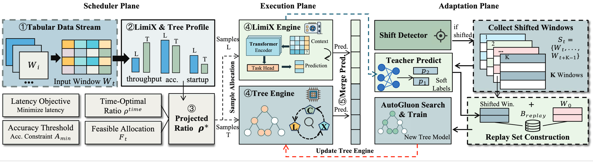

# 🚀 DUET: Dual-Engine Streaming Tabular Inference

[](https://www.python.org/)
[](https://pytorch.org/)
[](https://auto.gluon.ai/)

DUET coordinates a GPU-based foundation-model engine (FBE) and a CPU-based
tree-model engine (TBE) for streaming tabular inference under distribution
shifts. It combines accuracy-constrained window scheduling with asynchronous
replay distillation, using LimiX as the foundation model and AutoGluon for
tree-model search and training.

### Key Features

- **Dual-engine scheduling:** Allocate samples between CPU and GPU engines
  using calibrated accuracy estimates and execution profiles.
- **Feature-only drift detection:** Monitor incoming windows with PCA/PSI
  and collect replay windows only after a drift alert.
- **Asynchronous replay distillation:** Train a replacement tree model using
  teacher predictions and bootstrap data while active engines continue serving.
  Accepted replacements are activated at window boundaries.
- **Persistent inference workers:** Deploy one LimiX replica per visible GPU
  and persistent CPU workers for tree-model inference.

### System Overview



## 📁 Project Structure

```text
DUET/
├── main.py                         # Main experiment entry point
├── src/
│   ├── main.py                     # Streaming workflow and scheduling integration
│   ├── profile_models.py           # Offline engine profiling
│   ├── experiment_runtime.py       # Runtime settings
│   ├── engines/
│   │   ├── fbe/
│   │   │   ├── limix.py            # Foundation-model adapter
│   │   │   └── limix_parallel.py   # Persistent multi-GPU inference workers
│   │   └── tbe/
│   │       ├── autogluon.py        # Tree-model search and inference adapter
│   │       ├── autogluon_parallel.py  # Persistent CPU inference workers
│   │       └── distillation.py     # Teacher-supervised replay training
│   ├── data/                       # Dataset loading and stream construction
│   ├── detection/                  # PCA projection and PSI drift detection
│   ├── system/                     # Scheduling, profiling, and resource management
│   └── evaluation/                 # Per-window accuracy, macro-F1, and timing
├── inference/                      # Upstream LimiX inference implementation
├── model/                          # Upstream LimiX model implementation
├── utils/                          # LimiX utilities
├── config/                         # LimiX inference configuration
├── cache/                          # Downloaded model weights
├── dataset/                        # Input datasets
├── LIMIX_LICENSE.txt               # License for bundled LimiX source
├── requirements.txt                # Python dependencies
└── README.md
```

## 🛠️ Environment Setup

### Requirements

- Linux and Python 3.12.
- An NVIDIA GPU with a CUDA 12.8-compatible driver.
- At least 8 available CPU threads for the example below.

### Installation

```bash
git clone https://github.com/achieverzzbb/DUET.git
cd DUET

conda create -n duet python=3.12 -y
conda activate duet
python -m pip install -r requirements.txt
```

### Model Weights

Download the checkpoint from the [LimiX-2M repository](https://huggingface.co/stableai-org/LimiX-2M):

```bash
hf download stableai-org/LimiX-2M LimiX-2M.ckpt --local-dir cache
```

The checkpoint must be available at `cache/LimiX-2M.ckpt`.

## ▶️ Main Experiment

Run all commands below from the project root in the same shell.

### 1. Set the Experiment Parameters

```bash
export CUDA_VISIBLE_DEVICES=0
export DUET_DATASET=skin
export DUET_BOOTSTRAP_SIZE=6000
export DUET_WINDOW_SIZE=6000
export DUET_SHIFT_START_WINDOW=16
export DUET_TRAIN_TIME_LIMIT=60
export DUET_AUTOGLUON_FIT_STRATEGY=sequential
export DUET_AUTOGLUON_TRAIN_CPUS=4
export DUET_AUTOGLUON_CPUS_PER_MODEL=4
```

The example uses sequential AutoGluon search over five tree-model families:
LightGBM, CatBoost, XGBoost, Random Forest, and Extra Trees.
`DUET_SHIFT_START_WINDOW` controls synthetic stream construction only;
online PCA/PSI alerts trigger replay-window collection.

### 2. Build the Engine Profiles

```bash
python -u src/profile_models.py
```

This step measures engine accuracy and execution profiles for the scheduler
and saves them to `output/profiles/skin.json`.

### 3. Run DUET

```bash
python -u main.py
```

DUET processes the stream, detects distribution shifts, collects replay
windows, and runs asynchronous tree-model adaptation. Per-window results,
including engine allocation, PSI scores, accuracy, macro-F1, and timing,
are saved to `output/stream_*/results.csv`.
